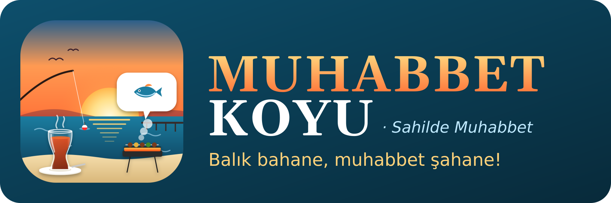

# 🏖️ Muhabbet Koyu — Sahilde Muhabbet
**Balık bahane, muhabbet şahane!**

Arkadaşlarınla sanal bir Akdeniz koyunda buluştuğun, çok oyunculu, **gerçek sesli sohbetli** 3D sahil yaşam simülasyonu. Balık tut, mangal yak, çay demle, havuza atla, meyve topla… ya da hiçbir şey yapmadan saatlerce muhabbet et.

Tek kod tabanı: **Web tarayıcısı, Windows, Android (APK + tarayıcı), iPhone/iPad (Safari, ana ekrana ekle)**.

---

## 🚀 GitHub'a yükleme ve yayına alma (sırayla)

### 1. GitHub'a yükle (tek zip dosyası olarak)
> GitHub zip dosyalarını kendisi açmaz. Bu yüzden önce küçük bir otomatik "zip açıcı" dosyası ekliyoruz.
1. github.com → sağ üst **+** → **New repository** → ad: `muhabbet-koyu` → **Add a README file** kutusunu işaretle → **Create repository**.
2. Depoda **Add file → Create new file**. Dosya adı kutusuna aynen yaz: `.github/workflows/muhabbet-koyu.yml`
3. `muhabbet-koyu.yml` dosyasının içeriğini kopyalayıp yapıştır → **Commit changes**.
4. **Add file → Upload files** → `MuhabbetKoyu.zip` dosyasını sürükle → **Commit changes**.
5. **Actions** sekmesinde "Zip açıldı" işi 1 dakikada biter. Depoyu yenile: tüm klasörler açılmış, zip silinmiş olur. ✅
### 2. Sunucuyu ücretsiz yayına al (Render.com)
1. render.com → GitHub ile giriş yap.
2. **New +** → **Blueprint** → `muhabbet-koyu` deposunu seç → **Apply**. (`render.yaml` her şeyi otomatik ayarlar.)
3. 3–5 dakika sonra adresin hazır olur: `https://muhabbet-koyu-xxxx.onrender.com` — bu adresi açınca oyun çalışır. Bilgisayar, telefon, tablet: hepsi bu adresten oynar.

> **Kalıcı kayıt için (önerilir):** Render ücretsiz planında disk kalıcı değildir. neon.tech'te ücretsiz PostgreSQL aç → bağlantı adresini kopyala → Render'da servis → **Environment** → `DATABASE_URL` olarak yapıştır. Para, envanter ve karakterler kalıcı olur.
> Render ücretsiz sunucusu 15 dk boş kalınca uyur; ilk girişte ~30 sn uyanma süresi olur.

### 3. Android APK (isteğe bağlı)
1. GitHub deposu → **Settings** → **Secrets and variables** → **Actions** → **Variables** sekmesi → **New repository variable**
   - Ad: `SERVER_URL` · Değer: `wss://muhabbet-koyu-xxxx.onrender.com/ws` (kendi Render adresin, başı `wss://`, sonu `/ws`)
2. **Actions** sekmesi → **Muhabbet Koyu** → **Run workflow**.
3. ~8 dakika sonra işin içinde **Artifacts → MuhabbetKoyu-APK** indir, zip'i aç, `app-debug.apk`'yı telefona kur ("bilinmeyen kaynaklar" iznini ver).

### 4. iPhone / iPad
Safari'de Render adresini aç → Paylaş → **Ana Ekrana Ekle**. Tam ekran uygulama gibi çalışır, mikrofon da çalışır.

### 5. Windows'ta kendi bilgisayarında çalıştırma
Node.js 22'yi kur (nodejs.org) → klasörde `START_WINDOWS.bat`'a çift tıkla → `http://localhost:8080`.
(Aynı Wi-Fi'deki arkadaşlar `http://BILGISAYAR-IP:8080` ile girebilir; ancak tarayıcılar mikrofonu yalnızca **https** ya da localhost'ta açar, bu yüzden sesli sohbet için Render adresini kullanın.)

---

## 🎮 Neler var?
| Sistem | Durum |
|---|---|
| Çok oyunculu odalar (özel/şifreli + herkese açık, 16 kişi), davet bağlantısı (WhatsApp/Telegram) | ✅ |
| **Gerçek sesli sohbet** (WebRTC), 3D mekânsal ses (HRTF), villa içi/dışı boğuklaşma, uzak mesafe sessiz | ✅ |
| Konuşanın ağzı hareket eder, diğer karakterler konuşana döner, sohbet kamerası | ✅ |
| Mikrofon aç/kapat, bas-konuş (V), hoparlör, sustur, engelle, şikâyet, özel grup sohbeti | ✅ |
| Balık tutma: olta + yem seçimi, şamandıra, "ÇEK!" zamanlaması, 12 tür, ağırlık/nadirlik, sat/pişir | ✅ |
| Mangal: 13 ürün, iki yüzlü pişme, çevirme, renk değişimi, duman, yanma, sahiplik, ikram | ✅ |
| 18 içecek (çay, kahve, ayran… + isteğe bağlı 18+ sanal alkollü), doldur/iç/masaya koy/ikram | ✅ |
| Mizahi sarhoşluk sistemi (5 seviye, sendeleme, ıskalanan sandalye, havuza düşme, toparlanma) | ✅ |
| Havuz (yüzme, atlama, su sıçratma), meyve bahçesi (7 meyve), villa (TV, buzdolabı, WC, duş) | ✅ |
| Gece-gündüz, 5 hava durumu, sahil radyosu (7 istasyon, telifsiz üretken müzik), ortam sesleri | ✅ |
| Karakter oluşturma (cinsiyet, ten, saç, kıyafet, şapka, gözlük, ayakkabı, aksesuar), 35+ animasyon | ✅ |
| Sahil Lirası ekonomisi, mağaza, envanter, görevler, haftalık yarışmalar | ✅ |
| Komik olaylar: martı yiyecek kapar, şemsiye uçar, bardak devrilir, kafaya meyve düşer, duman… | ✅ |
| Sunucu doğrulaması (hız/ışınlanma, ekonomi, sahiplik, spam), kalıcı hesap, otomatik yeniden bağlanma | ✅ |
| Mobil joystick + dokunmatik kamera, uyarlamalı grafik kalitesi | ✅ |

**Kontroller (PC):** WASD hareket · Shift koş · fare sürükle kamera · tekerlek yakınlaştır · **E** etkileşim · **Space** zıpla/oltayı çek · C bağdaş · B emote · I envanter · L mağaza · M mikrofon · V bas-konuş · Enter sohbet · ESC menü.

## 🧱 Teknik mimari
- **İstemci:** TypeScript + Three.js (Vite). Karakterler, dünya ve tüm animasyonlar prosedürel; dış model/ses dosyası yok (telif sorunu yok).
- **Sunucu:** Node.js + `ws`, yetkili (authoritative) oyun mantığı: ekonomi, balık zarı, mangal, sarhoşluk, olaylar sunucuda.
- **Ses:** WebRTC P2P mesh (16 kişiye kadar uygun) + Web Audio PannerNode. TURN için `TURN_URL`, `TURN_USER`, `TURN_PASS` ortam değişkenleri (bazı mobil ağlar için gerekebilir; ücretsiz: metered.ca).
- **Kayıt:** `DATABASE_URL` varsa PostgreSQL, yoksa `data/db.json`.
- **Testler:** `npm run test:server` (44 sunucu testi), `python3 tests/browser_test.py` (iki gerçek tarayıcı + telefon emülasyonu).

## ⚠️ Bilinen sınırlar (dürüst not)
- Grafikler prosedürel üretilmiş "stilize gerçekçi" düzeydedir; Unreal/Unity seviyesinde foto-gerçekçi insan modelleri değildir. Mimari, ileride sanatçı yapımı glTF modellerin takılmasına uygundur.
- Ses P2P mesh'tir; 16 kişiden büyük odalar için SFU (mediasoup/LiveKit) gerekir.
- iOS'ta sesli sohbet "uyumluluk modu" ile çalışır (mekânsal ses yerine mesafeye göre ses düzeyi).
- APK, debug imzalıdır (Play Store için release imzası gerekir).
